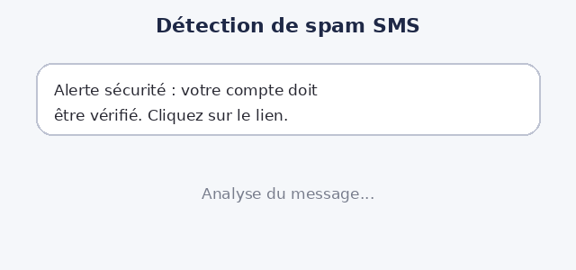

# Projet de détection de spam



Projet du mini-hackathon Data & IA (HETIC, 23 au 27 novembre 2026).
Objectif : classer un SMS en français comme **spam** ou **légitime**.

## Organisation de l'équipe

| Partie | Contenu | Responsable |
|---|---|---|
| Données | Chargement, nettoyage et export du jeu de données | Dylan RAMI |
| Modèle | Baseline et modèle scikit-learn (TF-IDF + MultinomialNB) | À compléter |
| Application | API FastAPI (/health, /predict) et interface Streamlit | À compléter |
| DevOps | Git, pytest, Docker Compose, GitLab CI | À compléter |

## Structure du dépôt

```
projet-detection-spam/
├── data/
│   ├── messages.csv        # jeu de données brut
│   └── processed/          # fichiers propres (train, validation, test)
├── notebooks/
│   └── analyse_fichier.ipynb   # exploration et nettoyage
├── src/
│   └── prepare_data.py     # script de préparation des données
├── docs/
│   └── detection-spam.gif
└── README.md
```

## Installation

Python 3.12.

```bash
python -m venv .venv
.venv\Scripts\activate      # Windows
pip install pandas
```

Les dépendances complètes (modèle, API, tests) sont à compléter par les autres parties.

## 1. Partie Données : Dylan RAMI

### Source et droits

- Jeu de données : French Spam Text Dataset
- Auteur : Djochrist
- Lien : https://github.com/Djochrist/french-spam-text-dataset-v1.0 (fichier `data/messages.csv`)
- Licence : aucune licence indiquée sur le dépôt
- Nature des données : messages synthétiques (générés), donc pas de vrais SMS de personnes réelles

Le fichier `data/messages.csv` est téléchargé depuis le dépôt de l'auteur. Chaque personne de l'équipe doit en avoir sa propre copie.

### Description des colonnes

| Colonne | Contenu |
|---|---|
| id | Identifiant du message |
| text | Texte du message |
| label | `spam` ou `legitimate` (devient `légitime` après nettoyage) |
| domain | Type de message : `sms` ou `email` |
| spam_category | Catégorie du spam (par exemple phishing) |
| split | Partition fournie : train, validation ou test |
| template_group | Groupe de messages issus du même modèle de texte |

Le fichier brut contient 10 000 lignes et 7 colonnes, sans valeur manquante.

### Ce que fait la préparation

1. Je garde uniquement les SMS (`domain == "sms"`) : 5 000 lignes.
2. Je harmonise les labels en `spam` et `légitime`.
3. Je vérifie les valeurs manquantes, les textes vides et les doublons : il n'y en a aucun.
4. Je garde les accents.
5. Je respecte les partitions fournies : train

Résultat : 2 500 spams et 2 500 SMS légitimes (classes équilibrées).

### Régénérer les fichiers

Depuis la racine du dépôt :

```bash
python src/prepare_data.py
```

### Limites

- Les données sont synthétiques : les scores du modèle risquent d'être plus élevés que sur de vrais SMS.
- Il n'y a que 52 modèles de texte (`template_group`), donc les messages se ressemblent beaucoup.
- La longueur seule sépare déjà bien les classes (spam : environ 171 caractères en moyenne, légitime : environ 116).

## 2. Partie Modèle

À compléter.

## 3. Partie Application

À compléter.

## 4. Partie DevOps

À compléter.